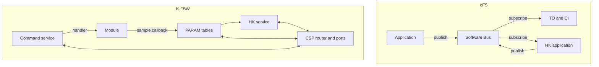

# K-FSW for cFS users {#cfs_concept_map}

[TOC]

NASA's core Flight System (cFS) is the reference most flight software
engineers know: the cFE core services, OSAL and PSP underneath, and a set of
applications that talk over the Software Bus. K-FSW solves many of the same
problems with a different shape. This page maps each cFS piece to what K-FSW
has in its place, or says that it has nothing, and then explains the
differences that change how you design with it.

## The shape in one picture

In cFS an application publishes messages and anything that subscribes gets a
copy: telemetry output, housekeeping, data storage. In K-FSW a module exposes
its state as parameters and its actions as commands, and whoever needs them
asks: the shell, housekeeping, or a ground node over CSP. There is no bus in
between and no message ID space.

## cFE core services

| cFS | What it does there | K-FSW | Notes |
| --- | --- | --- | --- |
| ES, Executive Services | Starts applications, restarts them, tracks reset types, keeps the Critical Data Store and the system log | `app/src/main.c` and the boot service (`kfsw-services/src/boot.c`) | Applications are compiled in and started in a fixed order by `main()`; there is no loader and no per-application restart. The reset cause and the last words note replace ES reset types; there is no Critical Data Store |
| SB, Software Bus | Publish and subscribe by message ID, through pipes | not provided | Inside a node, modules and services call each other's public C API, downward only. Between nodes, CSP ports. See [No software bus](#no-software-bus) |
| EVS, Event Services | Numbered events with type and filters, sent as telemetry | Event service (`event.h`) and logging (`log.h`) | Events are numbered records in a RAM ring, read by the ground with `event_tail`. Text goes to the log, which has per-module levels. There is no per-event filter table |
| TBL, Table Services | Application-owned binary tables, loaded, validated and activated by command | PARAM tables and the table service (`parameter.h`, `table.h`) | A K-FSW table is a set of named, typed fields, each with its own validation, not one opaque block. Ground-written table files are adopted on command. See [Parameters instead of tables](#parameters-instead-of-tables) |
| TIME | Mission elapsed time, spacecraft time, tone and 1 Hz sync | `kfsw-platform` time and wall clock (`time.h`, `wallclock.h`), CSP clock | Monotonic time for deadlines, wall time for stamps, set from the ground or an RTC. No tone or PPS distribution |
| FS header | File header for files written on board | not provided | Each file format carries its own magic, version and CRC32 |

## OSAL and PSP

cFS isolates the RTOS behind OSAL and the board behind the PSP, so the same
applications build on RTEMS, VxWorks, FreeRTOS or Linux. K-FSW does not have
that layer. It calls Zephyr directly, and Zephyr is what makes it portable:
the same code runs on any board Zephyr supports, and `native_sim` runs the
whole image as a Linux process, which is where cFS would use the POSIX OSAL.
Board specifics live in devicetree and in `kfsw-platform` (reset cause,
watchdog, last words, hardware ID, storage), which is the closest thing to a
PSP.

The cost is the one @ref zephyr_integration states: moving K-FSW to another
RTOS means porting every kernel, driver and filesystem call, not one
abstraction layer. The benefit is that there is no wrapper between a service
and the kernel, and Zephyr's own tests cover the kernel calls.

## cFS applications

| cFS application | K-FSW | Notes |
| --- | --- | --- |
| CI and TO, command ingest and telemetry output | The CSP router and the per-service ports (@ref communications) | Each service serves its own port: commands on 11, parameters on 10 and 12, HK on 14, files on 9. There is no CCSDS or PUS framing; links are KISS over UART or CAN |
| SCH, scheduler | not provided | Each service runs its own thread or work item with its own period. Time-tagged commands are file based operations |
| HK, housekeeping | HK service (`hk.h`) | A report is a list of parameters, local or on other nodes, collected at a period, stored and served on request or as a beacon. It reads parameters instead of combining bus messages |
| DS, data storage | HK store, journal and log history | No generic recorder; each service stores its own data |
| FM, file manager | FTP service and the `storage` shell commands | Listing, directories, upload and download with CRC32 over RDP |
| CF, CFDP | FTP over RDP, and FWU lite for images | Resumable, block CRC, but not CFDP |
| LC, limit checker | Limits service (`limits.h`) | One rule per parameter with a comparison, a dwell and a command to release. No combined action points |
| SC, stored commands | File based operations (`fbo.h`) | Procedures from files, and a time-tagged queue. Remote shell execution covers ad hoc sequences |
| CS, checksum | Image scrub (`scrub.h`) | Checks the image slots and Golden against a learned CRC32. Not RAM, tables or code segments in memory |
| MD and MM, memory dwell and manager | not provided | Only declared parameters are readable. The image slots can be read back as files over FTP |
| HS, health and safety | Health, the hardware watchdog, the resource monitor and the ground watchdog | @ref fault_recovery |
| SBN, Software Bus Network | CSP routing between nodes | A remote node is addressed directly; nothing is bridged |

## No software bus {#no-software-bus}

The Software Bus is the centre of a cFS design. It decouples applications
that run at different rates, lets several consumers see the same data, and
makes message flow observable. K-FSW gets those properties another way.

Rates are decoupled because nothing pushes. A module updates its state at its
own rate, and a reader takes a copy when it wants one, through the module's
snapshot call behind the parameter's sample callback. A slow reader never
blocks a fast producer, and there is no pipe to overflow.

Several consumers see the same data because every reader goes through PARAM:
the shell, HK, a limit rule and a ground station all read the same parameter
by name. Adding a consumer changes nothing in the module.

Flow is observable from the ground instead of from a bus monitor: every
command dispatch is an event, HK reports say what they sampled and when, and
CSP counts what every interface carried.

What this gives up is push. A module cannot announce a value to whoever is
interested; the interested party has to poll, or the module raises an event.
Two loops on one processor that exchange data every cycle call each other's C
API, downward only, which is what a cFS application does inside one
application too.

## Parameters instead of tables {#parameters-instead-of-tables}

A cFE table is a block of memory an application owns. Ground loads a new
image of it, the application validates the whole block and switches to it at
a point it chooses. A K-FSW parameter is one field with a name, a type, a
table and offset address, flags and callbacks. A write is validated one field
at a time by `.validate`, and `.changed` or `.apply` tells the module.

Most cFE tables hold settings that can change independently, and parameters
fit those better: the ground changes one gain without uploading the rest. For
a set of fields that must change together, the table service takes a file
written on the ground for one table, checks every entry before any of it takes
effect, adopts it when an operator says so, and can undo it afterwards.

Parameters flagged persistent are saved together in one snapshot and
restored at the next boot, which covers what cFE does with table images in
the file system and with the Critical Data Store.

## Scheduling

cFS runs each application as a task and uses SCH to wake them on a schedule.
K-FSW has no central scheduler. Each service that needs its own thread
defines it with a Kconfig priority, and the periodic monitors run as work
items on Zephyr's system workqueue:

| Priority | Runs there |
| --- | --- |
| System workqueue, cooperative | Health, watchdog keep-alive, resource monitor, scrub, limits, ground watchdog |
| 0 | CSP router (`KFSW_CSP_ROUTER_PRIORITY`), the `main()` loop |
| 1 | PARAM descriptor server |
| 2 | Command server, FTP |
| 3 | PARAM value server, HK server, remote execution, FWU lite, radio codec |
| 4 | HK collector |
| 5 and below | File based operations, the temperature example, the journal, the remote log server |

These are the defaults in each repository's `Kconfig`. A priority follows how
soon the work must run, not how important it is: the router is first because every service waits for it, and the HK
collector is low because a late sample is still a sample. A work item on the
system workqueue must not block, because the watchdog keep-alive runs there
too; a module that waits for hardware uses its own queue, as the temperature
example does.

## Checking commands

cFS splits command validation between CI, which checks the packet, and the
receiving application, which checks whether the command makes sense now.
K-FSW splits it the same way. The command service checks the argument count
and types against the definition before the handler runs. The handler checks
ranges and whether the module's current state allows the action, and returns
a status the ground sees.

## Boot and recovery

cFE leaves image selection to the PSP and the bootloader, and records the
reset type it finds. K-FSW makes the boot chain part of the framework:
MCUboot with signed images and trial swaps, an update service that writes the
inactive slot, a boot budget that counts unexplained resets, and a Golden
recovery image it installs when the budget runs out. @ref firmware_update and
@ref fault_recovery explain it.
