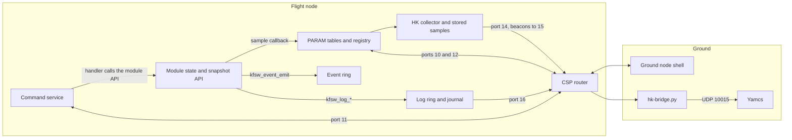

# Data flow {#data_flow}

[TOC]

A module owns its state. Everything else, the shell, the ground, housekeeping,
reads it through a service. This page follows a value, a command, an event and
a log line from the module that produces them to the ground.

There is no message bus between modules and services. Each arrow is a
function call inside the node or a CSP request on a fixed port. A module
does not know who reads its values, and a service does not know which module
a table belongs to.

## A parameter

A module keeps its state in its own variables, under its own lock, and copies
it out through a status call (`kfsw_temp_example_get()` in the temperature
example). Its parameter table points each read-only entry at a
`.sample` callback that calls that status function, so a read always gets a
current copy and never touches the module's state directly. The application
passes the module's table to `kfsw_param_init()` at startup, and from then on
the PARAM service owns the index: name, table, offset, type and flags.

A local `param get temp_mcu_mc` runs the callback and prints the value. A
remote one, `param get 2 temp_mcu_mc` from a ground node, sends a libparam
request to port 10 of node 2. The PARAM server there runs the same callback
and replies. Port 12 serves the descriptors, so a ground node can list
another node's tables without knowing them in advance. A write goes the
other way: the server runs the entry's `.validate`, stores the value, then
calls `.changed` or `.apply`, which is where the module's setter runs. See
@ref services for the write modes and persistence.

## Housekeeping

Housekeeping does not ask modules for anything. A report definition is a list
of `node:table:offset` references, set with `hk define` or the `hk_define`
command and saved with `CONFIG_KFSW_HK_PERSISTENCE`. The collector thread
reads each reference through the PARAM service at the report's period, local
or remote alike. `hk store` keeps the samples in a ring file in flash, so a
pass can read what was collected while the node was out of contact. The ground pulls them from port 14. A report with a beacon
interval is also sent unasked to port 15, where a ground listener picks it up.

`tools/ground/hk-bridge.py` is the usual reader. It speaks CSP over KISS on a
serial device, a Linux node's pseudo-terminal or the radio, requests samples
and forwards each one unchanged to Yamcs on UDP port 10015. Yamcs decodes them
with the mission database `hk-report.py` generates. @ref ground has the
commands.

## A command

A command is a named, numbered handler that a service or module defines and
the application registers (`command_sets[]` in `app/src/main.c`). The handler
checks its arguments, calls the module's public API, and fills a status and a
short `key=value` detail. The command server on port 11 runs the same
handlers for a remote caller, so `event tail 2 0` on a ground node and
`event tail 0` on the node's own console end in the same function. Every
dispatch is recorded as an event.

## An event

`kfsw_event_emit()` writes a record into a RAM ring: source, ID, severity, a
monotonic time stamp, a sequence number and a small payload, written
big-endian by the producer. It takes a spinlock for a few instructions, so an
interrupt handler may call it. The ring is read with the `event_stats` and
`event_tail` commands, locally or over port 11, and a gap in the sequence
numbers says what was overwritten. The ring is lost at a reset. With
`CONFIG_KFSW_JOURNAL`, the journal keeps boot reports and the events marked
important in flash, and `journal remote` reads them over port 16.

## A log line

`kfsw_log_info()` and its siblings print to the console and keep the line in a
RAM history. `log remote <node>` reads that history over port 16, which is
how a ground station sees a node's log without a console cable. Markers such
as `@BOOT` and `@READY` are log lines that tests and operators search for.

## What is not on this path

Nothing on the node pushes data to the ground except beacons. The ground asks:
a parameter read, an HK request, an event tail, a log read. A node out of
contact keeps collecting HK and keeps its rings, and the ground reads what is
left when the next pass starts.
