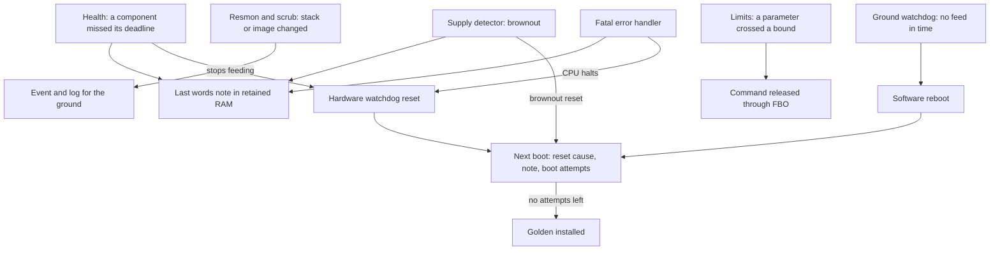

# Fault detection and recovery {#fault_recovery}

[TOC]

Fault handling in K-FSW is not one service. Each mechanism watches one thing
and does one thing when it goes wrong, and most of them do no more than tell
the ground. The ones that act have a fixed order: report, then a command the
operator wrote in advance, then a reset, and after enough unexplained resets,
the recovery image. This page puts them on one page; @ref services has each
one in detail.

## Watching

Two monitors only report. The resource monitor (`KFSW_RESMON`) sweeps the
kernel's thread list and raises an event when a thread's stack use reaches
the alert level. The image scrub (`KFSW_SCRUB`) re-reads the image slots and
the Golden partition, compares a CRC32 against a reference the operator
learned, and raises an event when one changes. Neither changes anything on the
node. An operator reads the events, or a limit acts on the parameters they
publish.

## Acting on a value

Limits (`KFSW_LIMITS`) watch numeric parameters. A rule names a parameter, a
comparison, a bound, how many consecutive sweeps it must hold, and a command
to release. The command goes through the file based operations scheduler, so
the release is logged and can address another node. This is where a mission
writes its local recovery: switch off a load, change a mode, restart a
subsystem. The rule file is uploaded like any other file, and nothing in the
image has to change.

## Resetting

Three mechanisms reset the node, each for a different question.

Health (`KFSW_HEALTH`) asks whether the threads still run. Each watched
component has a deadline: the main loop (`app`) and a loopback ping through
the CSP router (`csp`) in the reference build. While all of them report in
time, health feeds the hardware watchdog. When one misses, health writes a
`starved` note and stops feeding, and the watchdog resets the MCU. On the
NUCLEO that is the independent watchdog with an 8 s timeout. `main()` arms
it before anything else, and a keep-alive on the system workqueue feeds it
until health takes over at the end of startup.

The ground watchdog (`KFSW_GNDWDT`) asks whether anybody still talks to the
node. Only a feed command from the ground restarts its countdown, 24 hours by
default. At zero it reboots the node, on the assumption that a node nobody
has reached for a day has lost its way and should start again from a known
state.

A fatal error writes the faulting address into the last words note
(`app/src/fatal.c`) and halts the CPU, and the hardware watchdog resets it.
A fault before `main()` arms the watchdog has nothing to reset it.

## Across a reset

The last words note is a small record in RAM that a reset does not clear. The
code that causes a reset writes why: `commanded` from a reboot command,
`starved` from health, `fatal` with the faulting address, `brownout` from the
supply detector where the board has one. At the next boot,
`kfsw-services/src/boot.c` reads it together with the hardware reset cause,
and table 32 shows both (`last_reason`, `last_detail`, `last_uptime_ms`,
`boot_reset_cause`). A power cut clears the RAM, so no note means either a
power loss or a reset nothing explained.

With `CONFIG_KFSW_BOOT_BUDGET`, every reset that is not a commanded reboot
spends one boot attempt before `main()`. A run of resets the node cannot
explain therefore ends with the Golden recovery image installed, after the
bootloader has had the chance to revert an unconfirmed update. A run that
stays healthy for `CONFIG_KFSW_BOOT_BUDGET_STABLE_S` refills the count, so
only startups that never became stable add up.
@ref firmware_update has the sequence.

The persistent journal (`KFSW_JOURNAL`) keeps boot reports and important
events in flash, and the trial diagnostics in `/kfsw/boot-trial.dat` count
the unconfirmed boots of the running image. A ground station reads both at
the next pass to learn what happened while nobody was listening.

## What is not here

There is no central fault manager and no spacecraft mode. A mission that
needs one builds it on these pieces: the events and parameters say what is
wrong, limits and procedures act on them, and the resets are the last line.
