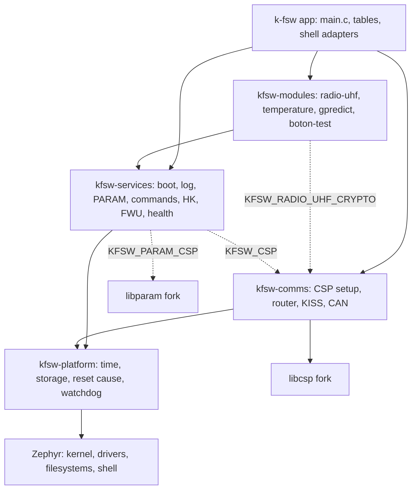
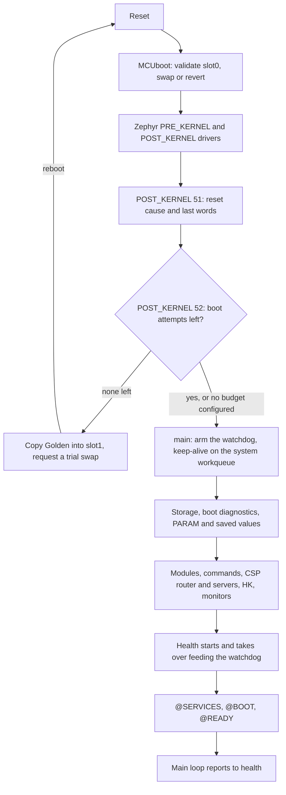

# Architecture {#architecture}

[TOC]

## Repositories

`k-fsw` builds the application from four reusable repositories.
It selects features, binds hardware, and orders startup.

| Repository | Contents |
| --- | --- |
| `k-fsw` | Application startup, target configuration, shell adapters, tools, integration tests, docs, and `west.yml` |
| `kfsw-platform` | Time, reset cause, watchdog, retained reset notes, and storage over Zephyr |
| `kfsw-services` | Boot, logging, parameters, persistence, files, commands, events, health, housekeeping, and firmware update |
| `kfsw-comms` | libcsp setup, one router, routes, UART/KISS and CAN interfaces |
| `kfsw-modules` | Device and subsystem clients, including UHF, button/LED, and temperature examples |

Shared code goes in the repository listed above. Shell handlers parse
arguments, call a public API and print the result.

Zephyr supplies the kernel, drivers, filesystem integration, shell, and build
tools. [libcsp](https://github.com/libcsp/libcsp) supplies the network stack;
[libparam](https://github.com/spaceinventor/libparam) supplies the remote
parameter codec. The manifest pins K-FSW forks; each keeps its upstream licence.

## Dependencies

Each repository may call the ones below it and never the ones above. The
arrows point at what a repository is allowed to call; the dashed ones exist
only when the option on the label is enabled.



The arrows come from the build, not from a convention. `kfsw-comms` links
`kfsw::platform` and `csp` (`kfsw-comms/CMakeLists.txt`) and its
`zephyr/module.yml` depends on `kfsw-platform` and `libcsp`. `kfsw-services`
links `kfsw::platform` always, `kfsw::comms` only with `CONFIG_KFSW_CSP` and
the libparam codec only with `CONFIG_KFSW_PARAM_CSP`
(`kfsw-services/CMakeLists.txt`). Each module links `kfsw::platform` and
`kfsw::services`; `radio-uhf` adds `kfsw::comms` and mbedTLS for its link
encryption (`kfsw-modules/radio-uhf/CMakeLists.txt`). The application links
all of them (`app/CMakeLists.txt`). Every layer also calls Zephyr directly;
the diagram draws that once.

Two consequences follow. A service never includes a module header, so a
module can be removed by turning its Kconfig option off without touching the
services. And the communications layer never calls the services: PARAM, FTP
and the command server bind their own CSP ports, and the router only delivers
packets to them. None of these layers depends on `k-fsw/app`.

Local parameters and persistence can run with CSP disabled:

```text
CONFIG_KFSW_PARAM=y
CONFIG_KFSW_PARAM_PERSISTENCE=y
CONFIG_KFSW_STORAGE=y
CONFIG_KFSW_PARAM_CSP=n
CONFIG_KFSW_CSP=n
```

FTP needs CSP and storage. The remote parameter adapter needs CSP and the
local parameter core. Kconfig checks these dependencies.

## Configuration

| Input | Sets |
| --- | --- |
| `west.yml` | Exact dependency revisions |
| `config/targets/<target>.env` | Zephyr board and local tool defaults |
| `app/prj.conf`, board `.conf`, profile `.conf` | Enabled software and defaults |
| Board devicetree and overlays | Devices, wiring, and flash partitions |
| `app/src/main.c` | Initialization order and error handling |

Use `west manifest --resolve` to inspect revisions. See @ref targets for
profiles and @ref zephyr_integration for generated configuration.
Changing RTOS requires adapting the Zephyr APIs used by the selected code;
moving to another Zephyr board usually changes configuration and device bindings.

## Device modules

A module has its own device state, public API and parameter table.
The application selects it and passes its definition set to PARAM.

- `radio-uhf` reports the selected Holybro SiK identity and expected serial
  configuration. The UART/KISS data path is in `kfsw-comms`.
- `boton_test` handles debouncing, the press count, the last press time and
  the LED state.
  Table 67 exposes its values. Use `kfsw_boton_test_get_status()` for a
  consistent snapshot of all five fields.
- `temperature-sensor-example` reads a configured sensor and publishes
  samples and status in table 51.
- `gpredict` follows a pass on a ground station: it takes the bearings and
  frequencies Gpredict sends over the hamlib protocols, holds or parks the
  antenna when they stop, and reports its state in table 52.

Hardware is selected in devicetree. A module should not select a board
by name or duplicate a router, transport, or service.

## Application startup

A node starts in three stages: the bootloader, the Zephyr init levels, and
`main()`. Only the last one is K-FSW's own code, but the first two decide
what it can rely on.



MCUboot is only there in the MCUboot profiles (@ref firmware_update); on
KFSW-Linux and the plain NUCLEO build the image starts directly. It checks the
signature of the primary slot on every boot, swaps in a trial image when one
is requested, and reverts an unconfirmed trial on the reset after it.

Two K-FSW functions run before `main()`, as `SYS_INIT` hooks.
`capture_reset` (`kfsw-services/src/boot.c`, `POST_KERNEL` 51) reads and clears
the hardware reset cause and takes the last-words note from retained RAM. With
`CONFIG_KFSW_BOOT_BUDGET`, `early_budget` (`kfsw-services/src/boot_budget.c`,
`POST_KERNEL` 52) spends one boot attempt for every reset that was not a
commanded reboot. When none is left it installs the Golden image through the
update service and reboots; MCUboot then swaps Golden in as a trial. The
budget is explained in @ref firmware_update.

`main()` (`app/src/main.c`) then runs these stages, each only when its
feature is enabled:

1. Arm the hardware watchdog and start its keep-alive. This comes first so
   that a hang in the flash or filesystem work below still ends in a reset.
2. Mount storage, record the boot in the trial diagnostics, and confirm the
   image if the build confirms itself at start (Golden does).
3. Register the parameter tables, restore saved values and count the restart.
4. Initialize device modules and file based operations.
5. Register command definitions.
6. Initialize CSP and its interfaces, start the PARAM server and the router,
   then the remote log, FTP, FWU lite, remote execution and command servers.
7. Initialize housekeeping and start its collector and server.
8. Start the resource monitor, image scrub, limits and the ground watchdog.
9. Register the main loop and the CSP router probe with health and start
   health. From here health, not the keep-alive, feeds the watchdog.
10. Apply shell settings, watch the supply, set the native host clock and
    start the journal.
11. Print `@SERVICES` with the number of failed stages, then `@BOOT`,
    `@SOURCE` and `@READY`, and enter the loop that reports to health.

A failed stage is logged and counted, and startup carries on with the stages
that do not depend on it. `@READY` means startup has finished, not that every
service started: `@SERVICES degraded failures=N` says how many did not. Check
`storage info`, `csp info` or the service status. The shell prompt can appear
before `@READY`.

The flight image is confirmed by the ground, by writing `boot_confirmed` in
table 32 once the operator has checked the node. Nothing in the startup
sequence confirms it.

## State and concurrency

| State | Kept in and protected by |
| --- | --- |
| Storage readiness | Platform storage mutex |
| Parameter values | Each component's storage; PARAM validation and callbacks |
| Parameter index | PARAM mutex and bounded static index |
| Persistence workspace | Persistence mutex and PARAM locking |
| Button and LED snapshot | Module mutex |
| CSP routes and interfaces | Communications; initialized once |
| UART/KISS receive state | One context per interface |
| FTP client | One static workspace, serialized by a mutex |
| FTP server | One worker; overlapping requests return busy |
| Events | Bounded RAM ring protected by a short spinlock |

Parameter reads of individual fields do not provide a consistent multi-field
snapshot. Use the module's snapshot API when the fields must agree.

After passing a packet to a send call, don't reuse or free it, even if the
send fails.

## Time

`kfsw_time_monotonic_ms()` and `kfsw_time_monotonic_us()` return elapsed
time for deadlines and durations. Resolution depends on the selected Zephyr
clock source.

The CSP clock API gives wall time from the RTC for timestamps. Setting it
doesn't change monotonic deadlines.

## Further reading

- @ref data_flow follows a value, a command, an event and a log line to the
  ground.
- @ref fault_recovery puts the watchdogs, monitors and recovery paths on one
  page.
- @ref persistence shows what is kept in flash and who owns it.
- @ref cfs_concept_map maps K-FSW to cFS.
- @ref services covers the services, storage and parameter formats.
- @ref communications covers packet flow, interfaces and routes.
- @ref development covers changing a dependency and its manifest pin.
- @ref project_status lists known limits and test results.
