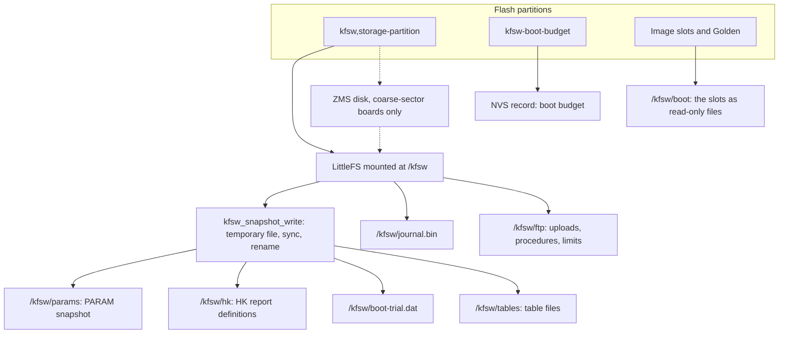

# Persistence {#persistence}

[TOC]

What a node keeps across a reset lives in three places in flash, and each has
its own owner. Most of it is files in one LittleFS volume. The boot budget is
a separate record, because it must be read before the filesystem is mounted.
The images themselves are partitions that only the bootloader and the update
service write.

## The volume

`kfsw-platform` owns the storage partition (`src/storage.c`). It mounts
LittleFS at `/kfsw`, refuses to format anything that is not fully erased, and
reports capacity. Every service above it uses the ordinary Zephyr filesystem
API once the volume is mounted, so a service has no idea which flash is
underneath.

On a board whose flash has only a few large sectors, LittleFS cannot hold a
directory tree directly. There the platform puts a ZMS disk between the
partition and LittleFS (`src/storage_zms_disk.c`): many small logical sectors
over the large physical ones. Nothing above LittleFS changes. The NUCLEO-L496ZG
does not need it; the F746 profile does. @ref services has the measurements.

A second, small volume at `/kfsw/tmp` is a RAM disk formatted at every boot,
for files that must not survive one.

## Small records

Most of what a service saves is one small record that must be either the old
version or the new one, never half of each. `kfsw_snapshot_write()`
(`kfsw-services/src/snapshot_file.c`) writes a temporary file, syncs it and
renames it over the old one. LittleFS makes the rename atomic, so a power cut
at any point leaves one complete copy.

Four services use it: the parameter snapshot, the HK report definitions, the
boot trial record and the table files. Each record has the same shape: a magic
or version, big-endian fixed-width fields, and a trailing CRC32 that the
loader checks before applying anything. A record that fails the check is
reported and the compiled defaults stay.

The parameter snapshot holds every parameter flagged persistent, across all
tables, by name. Loading skips names it does not know and types that changed,
so an image built later keeps the values it still understands. It is written
by `param save` and read once, at startup.

## Logs and files

The journal (`/kfsw/journal.bin`) is a ring written by its own thread. It keeps
boot reports and important events, not every log line, and it accepts losing
the newest queued record in a power cut. `hk store` keeps each report's
samples in a ring file of fixed-size slots under `/kfsw/hk`, overwritten
oldest first.

Under `/kfsw/ftp` are the files an operator uploads: procedures for file based
operations, the limits rules and anything else sent with `ftp put`. The radio
module keeps its key in `/kfsw/radio-uhf.key`, outside that root, so no file
transfer can read it.

`/kfsw/boot` is not stored in LittleFS. With `CONFIG_KFSW_FWU_FILES` the update
service mounts the two image slots there as read-only files, so the ground can
read an image back with FTP.

## The boot budget

The boot budget is an NVS record in its own two-page partition
(`kfsw-platform/src/boot_store.c`), not a file. It is read and written at
`POST_KERNEL` level, before `main()` mounts the filesystem, so a node whose
filesystem is broken still counts its boots. It is also kept out of the
parameter snapshot on purpose: restoring an old snapshot must never give back
attempts the node has already spent. @ref firmware_update explains the budget.

## What does not persist

The event ring, the log history and the live HK state are RAM. The last words
note is RAM that a reset does not clear, but a power cut does. A value that
must survive a power cut has to be written to one of the places above.
