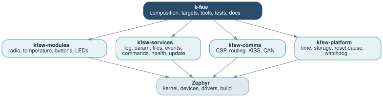

# K-FSW (KFSW) flight software manual {#k_fsw_manual}

K-FSW, also written KFSW, is flight software for small-satellite nodes built
on Zephyr. It provides a console, CSP links over UART/KISS and CAN,
parameters, files, logs, events, commands, housekeeping and firmware updates.
Each node, whether OBC, radio, ADCS, EPS or payload, enables the services it
needs in Kconfig and adds its own modules.

## Start here

| Task | Page |
| --- | --- |
| Build and run a Linux node | @ref getting_started |
| Flash a board and check its interfaces | @ref targets |
| Connect a ground node or record telemetry in Yamcs | @ref ground |

## Reference

| Topic | Page |
| --- | --- |
| Shell syntax and examples | @ref commands |
| Parameters, persistence, logging, files, commands, events | @ref services |
| CSP addresses, routes, UART/KISS, and CAN | @ref communications |
| Upload, boot, confirm, and roll back an image | @ref firmware_update |
| Every parameter and command, generated from the image | @ref icd |
| Public C headers and functions | @ref api_reference |

## Repository layout



`k-fsw` selects the modules and services, binds hardware, and orders startup.
The other four repositories hold reusable code. `west.yml` pins the
revisions used together.

## Zephyr

Zephyr provides the RTOS, device drivers, board support, Kconfig, devicetree,
and build tools. Its native simulator runs the application on Linux, so
service and link tests can run before hardware is available.

A new Zephyr target supplies its own hardware description and
configuration; no service names a board. Porting to another RTOS means
adapting the Zephyr kernel, driver and filesystem calls in each module and
service. See @ref zephyr_integration.

CSP is optional. Local parameters, persistence, logging and the shell work
without it.

## First run

From a configured west workspace:

```bash
./k-fsw/tools/kfsw-linux build
./k-fsw/tools/kfsw-linux run
```

After `@READY`, try `status`, `param whichtables`, `storage info`, and `csp info`.
See @ref getting_started for workspace setup.

## Development

- @ref architecture covers repositories, startup and configuration.
- @ref cfs_concept_map maps K-FSW to cFS for readers who know it.
- @ref development covers branches, dependency changes and pull requests.
- @ref testing covers software checks and hardware tests.
- @ref project_status lists bench results and known limits.

Linux and NUCLEO-L496ZG are the reference targets. FRDM-K64F runs a
shell-only image. Pico W builds with the core services, which have not been run
on the board.
