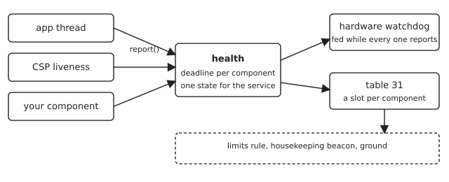
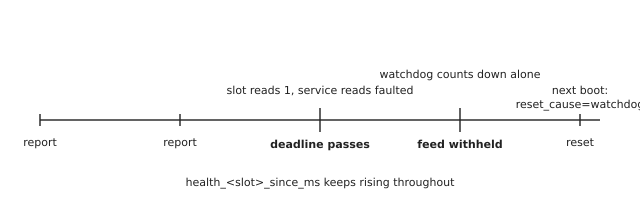

# Using health {#health-guide}

Health watches the components that have to keep running, and it is the only
thing that feeds the hardware watchdog. If a component stops reporting inside
its deadline, health stops feeding, and the watchdog resets the node. That is
the whole mechanism, and everything below is how to take part in it.

It is deliberately narrow. Health answers "is this component still reporting on
time", not "is this unit fit to use". Nothing in it chooses between a working
radio and a spare, and nothing in it decides to degrade instead of resetting.
Those are jobs for `limits` and the command registry, and the last section shows
how to reach them from here.



## Where it runs

Health gates a hardware watchdog, so it is composed where there is one. The
NUCLEO L496 image carries it; the hosted `linux` image does not, because
native_sim has no independent watchdog to withhold. Reading `health status` on
the hosted image therefore tells you nothing, and the suites that cover health
run on `native_sim` with the service switched on explicitly.

| Option | What it sets |
| --- | --- |
| `CONFIG_KFSW_HEALTH` | the service itself |
| `CONFIG_KFSW_HEALTH_MAX_COMPONENTS` | how many may register, 8 by default |
| `CONFIG_KFSW_HEALTH_SLOTS` | publish each component in table 31 |
| `CONFIG_KFSW_HEALTH_SLOTS_HEADER` | the header naming this composition's slots |

## Having a component watched

Two steps, and both are needed. First the component registers and then reports
inside the deadline it asked for:

```c
static uint8_t handle;

int start(void)
{
	int result = kfsw_health_register("myservice", 5000U, &handle);
	if (result != 0) {
		return result;
	}
	/* then, from the component's own loop, inside every 5000 ms: */
	return kfsw_health_report(handle);
}
```

A component that registers and never reports is worse than one that never
registers: it will withhold the feed and reset the node. Register at the point
where you can promise the reporting.

Second, the composition names it as a slot, so the ground can see it:

```c
/* app/include/kfsw/app/health_slots.h */
#define KFSW_HEALTH_SLOTS(SLOT)                                                \
	SLOT(app, 0)                                                           \
	SLOT(csp, 1)                                                           \
	SLOT(myservice, 2)
```

The index fixes the wire offsets, so it is never reused or renumbered. Removing
a component leaves its index unused rather than shifting the ones after it.

The name appears twice, once in the registration and once in the slot list, and
nothing in C ties them together. `tools/ci/health-slots.py` does, and it runs
inside `quality.sh`: it refuses a slot nothing registers, a registration no slot
names, and a duplicated index. A typo there would otherwise read as a component
that died before it ever reported, for the life of the image.

## Reading it

From the shell:

```text
health status            whether the watchdog is being fed, and why
health list              each watched component and its deadline
health watch <name> <ms> watch a component nothing reports, for testing
health report <handle>   report one alive by hand
```

From the parameter table, which is what the ground and a `limits` rule see.
Table 31 carries the service as a whole:

| Parameter | Meaning |
| --- | --- |
| `health_state` | 0 ok, 1 faulted, 2 stopped |
| `health_feeding` | whether health is the one feeding the watchdog |
| `health_faults` | deadline faults since boot |
| `health_feeds` | feeds issued since boot |
| `health_faulted_by` | the component that caused the current fault |
| `health_components` | how many are registered |
| `health_interval_ms` | how often health checks |

and two parameters for each slot the composition names:

| Parameter | Meaning |
| --- | --- |
| `health_<slot>_state` | 0 ok, 1 overdue, 2 absent |
| `health_<slot>_since_ms` | milliseconds since its last report; `4294967295` when absent |

`absent` means nothing of that name is registered in this image. It is not the
same as a component that is late, and the two must not be read as one: a slot
that reads absent on a build you expected to carry it means the registration is
missing or misspelled, not that the component is unwell.

Ok is zero for both the service and a slot, so `> 0` is the useful comparison.

## What happens when a component goes overdue



Health notices at its next check, marks the slot overdue, sets the service
faulted and names the component in `health_faulted_by`. From that moment it
stops feeding the watchdog, and the watchdog runs down on its own. Nothing else
intervenes: there is no retry, no attempt to restart the component, and no
degraded mode. The node resets, and the boot afterwards reports
`reset_cause=watchdog`, which is how an operator tells this reset from a
commanded one.

Two consequences worth holding on to. A single late component takes the whole
node down, so a deadline should be generous enough to survive the worst sweep
the component can have. And because the watchdog is the actuator, the margin
between a missed deadline and the reset is the watchdog timeout, not something
health chooses.

## Reacting before the reset

A `limits` rule can watch a slot and release a command before the watchdog
finishes counting. Rules live in a text file under the FTP root, five
whitespace-separated fields and then the action:

```text
# parameter            cmp  bound  dwell  node  action
health_csp_state       >    0      2      0     event stats
health_app_since_ms    >    4000   1      0     log tail 20
```

`dwell` is how many consecutive checks the comparison must hold before the rule
fires, which keeps one slow sweep from releasing anything. The rule fires once
per crossing and re-arms when the comparison goes false again. The `node` column
is where the action is released, so a rule on one node can act on another.

This is the seam to use when a reset is too blunt an answer. Health will still
withhold the feed on its own schedule; a rule only gives you something that
happens first.

## Proving it

The unit suites cover the service and the slots on `native_sim`:

```bash
./k-fsw/tools/ci/unit.sh --test kfsw.services.health
./k-fsw/tools/ci/unit.sh --test kfsw.services.health.parameters
```

The second is the slots: a registered slot reads ok and its age advances, an
overdue slot reads overdue, an unregistered slot reads absent, registration
order does not decide which slot a component gets, and the aggregate parameters
keep their offsets.

On hardware, with a NUCLEO L496 on its ST-LINK:

```bash
KFSW_DEBUG_SERIAL=/dev/serial/by-id/usb-...-if02 \
  ./k-fsw/tests/hil/health/health-reset.sh
```

That one is the mechanism end to end: the board stays up past three watchdog
timeouts while healthy, both slots read ok, the age is sampled rather than
constant, a component that stops reporting resets the board, the next boot names
the watchdog, and the slots read ok again afterwards. It also checks that a
component registered at run time creates no parameter, because the slots are
compiled and a table that grew at run time would break the document and the wire
offsets with it.
