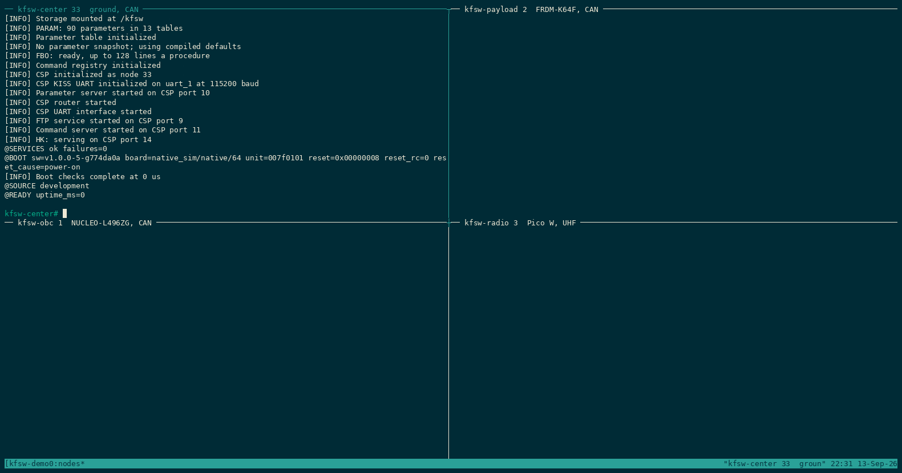

# Boards and targets {#targets}

[TOC]

## Supported targets

A Zephyr board selects the SoC, devices and flash runner. A K-FSW target adds
the application configuration and tool defaults in `config/targets/<target>.env`;
for example `rpi_pico_w` maps to `rpi_pico/rp2040/w`.

| Target | Zephyr board | Default composition | Tested |
| --- | --- | --- | --- |
| `linux` | `native_sim/native/64` | Full reference composition, including the journal, HK store, command retry and FWU | Software tests in CI |
| `nucleo_l496zg` | `nucleo_l496zg` | Full MCU composition; shell on the ST-LINK, CSP on USART3 | CI build; boot, storage, UART/KISS, CSP, remote parameters and FTP on the bench |
| `frdm_k64f` | `frdm_k64f/mk64f12` | Shell only until tag 2.0 | Boot and shell on the board |
| `rpi_pico_w` | `rpi_pico/rp2040/w` | Core services; USB shell, UART0 CSP, persistent LittleFS | Software build only; service HIL not run |

The board files are `app/boards/<board>.conf` and `.overlay`. Only `linux` and
`nucleo_l496zg` are built in CI.

### Required board transports

Every supported hardware board must carry CSP over both CAN and UART/KISS, and
board acceptance checks both links on the normal image and, where there is
one, the Golden image. Each composition defines its routes explicitly; there
is no automatic failover.

| Board | Transport status | Remaining work |
| --- | --- | --- |
| NUCLEO-L496ZG | UART/KISS in the board configuration; CAN from `nucleo-can.conf`. The update images enable both. | Make both links part of the standard composition and acceptance matrix. |
| NUCLEO-F746ZG | The A and Golden images built by `tools/f746-proof.sh` use CAN1 PD0/PD1 at 500 kbit/s and UART/KISS on USART6, route `1 KISS,0/0 CAN`. CAN needs an external transceiver. | Verify both links on A and Golden. Not run on hardware. |
| Pico W | UART/KISS only. The RP2040 has no CAN controller, so a transceiver alone is not enough. | Choose an external CAN controller with a Zephyr driver, record its wiring, check RAM and test both links. |
| FRDM-K64F | Shell only, although the SoC has a CAN peripheral. | CAN and a UART/KISS link in the 2.0 work. |

## Identifying a unit

Every target reports its chip's unique ID: as `unit=` in the boot marker, in
`status` and `version`, and as `hw_id` in the board table. It is 96 bits on the
STM32L496, 128 on the Kinetis K64 and 64 on the RP2040. The CSP model is the
board target, so `csp ident` names the hardware too.



The FRDM and the Pico in this recording run bench configurations with CSP on
CAN and behind a UHF radio, not their current default images.

## KFSW-Linux

KFSW-Linux is the application built for Zephyr's 64-bit native simulator. It
compiles the same sources as the NUCLEO build, on simulated devices. Use it for
software tests; measure timing, interrupt load and flash behaviour on the MCU.

```bash
./k-fsw/tools/kfsw-linux build
./k-fsw/tools/kfsw-linux run
```

The executable is `build/linux/zephyr/zephyr.exe`, and the runner gives it
`build/linux/kfsw-storage.bin` as flash; tests use their own flash files. The
shell uses stdin/stdout. A line such as

```text
uart_1 connected to pseudotty: /dev/pts/...
```

is the CSP UART, not the console.

CI builds the target and a composition without CSP. Twister runs the unit
tests, the integration and Robot tests start one or two full processes, and
Valgrind checks a normal boot and one with a corrupted snapshot.
`tests/config/linux-node2.conf` configures the second test node.

## NUCLEO-L496ZG

The NUCLEO image carries storage, local and remote parameters, persistence,
CSP over UART/KISS, FTP, commands, events, housekeeping and beacons, log
history and remote logs, last words, remote execution, file based operations,
limits, the resource monitor, the ground watchdog, the hardware watchdog and
health. Flash is split into a 960 KiB application partition and a 64 KiB
LittleFS partition.

| Connection | Hardware | Use |
| --- | --- | --- |
| Debug console | ST-LINK virtual COM, LPUART1 | Shell, logs and boot markers |
| CSP link | USART3, PD8 TX and PD9 RX | 115200 8N1 KISS |

CSP reception is interrupt driven. The NUCLEO is node 2 and sends traffic for
every other node to the KISS interface.

### Button and LED example

`button_test` is not in the default image. Build it with:

```bash
KFSW_EXTRA_CONF_FILE="$PWD/k-fsw/config/profiles/nucleo-button-test.conf" \
KFSW_EXTRA_DTC_OVERLAY_FILE="$PWD/k-fsw/config/profiles/nucleo-button-test.overlay" \
  ./k-fsw/tools/build.sh nucleo_l496zg
```

The overlay maps the USER button and the green, blue and red LEDs (LD1 to LD3)
to the module's chosen properties, so the pins stay in devicetree. The button
is debounced for 30 ms on the system workqueue, and its values are in table 67.
The manual test is in `tests/hil/button-test/`.

### Wall clock

The default image keeps wall time in the RTC (`CONFIG_RTC` and the
`kfsw,rtc` chosen node), and `csp clock set <seconds>` sets it. The RTC
counter is not cleared by a reset. The board devicetree clocks the RTC from
the LSI. In a composition without an RTC, setting and reading the wall clock
returns `-ENOTSUP`.

`config/profiles/nucleo-clock.conf` and `nucleo-clock.overlay` add Zephyr's
counter and POSIX clock APIs on top; no test or tool uses them.

### Last words

The image keeps a short note across a restart and watches the supply voltage, so
a node can report why it went down. `param get last_reason`, `last_detail` and
`last_uptime_ms` read it, and the note is cleared once reported.

### MCUboot

The bootloader is not in the default image. Build it with sysbuild:

```bash
P="$PWD/k-fsw/config/profiles"
KFSW_SYSBUILD=1 \
KFSW_MCUBOOT_KEY="$HOME/.config/kfsw/mcuboot-signing-key.pem" \
KFSW_EXTRA_CONF_FILE="$P/nucleo-mcuboot.conf" \
KFSW_EXTRA_DTC_OVERLAY_FILE="$P/nucleo-mcuboot-flash.overlay;$P/nucleo-mcuboot.overlay" \
KFSW_MCUBOOT_DTC_OVERLAY_FILE="$P/nucleo-mcuboot-flash.overlay" \
  ./k-fsw/tools/build.sh nucleo_l496zg
```

`nucleo-mcuboot.conf` turns the bootloader on and the two overlays lay out the
flash for it.

| Partition | Address | Size |
| --- | --- | --- |
| `boot_partition` | `0x000000` | 64 KiB |
| `slot0_partition` | `0x010000` | 352 KiB |
| `slot1_partition` | `0x068000` | 352 KiB |
| `kfsw_golden_partition` | `0x0C0000` | 188 KiB, recovery image |
| `kfsw_boot_budget_partition` | `0x0EF000` | 4 KiB, early boot budget |
| `kfsw_storage_partition` | `0x0F0000` | 64 KiB |

The bootloader and the application use the same flash map overlay. The
storage partition stays at `0xF0000`, so an existing filesystem survives the
move to MCUboot; the rollback test checks that a stored value is still there
after every swap.

The golden partition holds the recovery image built by `tools/golden.sh` from
`config/profiles/nucleo-golden.conf`: CSP, parameters, the command server and
both update routes, and nothing else. It is signed and linked like any other
image. The bootloader only boots the slots, so installing it means copying it
into the secondary slot and swapping. `golden_install` does that on command,
and the boot service does it on its own once `boot_attempts_left` reaches zero.

#### Signing

The signing key is private and kept outside the repository. With
`KFSW_MCUBOOT_KEY` the build puts its public key in the bootloader and signs
the application. `tools/build.sh` refuses a sysbuild build without it. MCUboot's
development key, which anyone can sign with, is used only when
`KFSW_MCUBOOT_KEY` names it, as CI does; the rollback test checks that a board
built with the real key rejects an image signed with it.

Bootloader settings go in `app/sysbuild.conf` as `SB_CONFIG_*` symbols.
Sysbuild overrides settings placed in a fragment on the bootloader image.

### Watchdog

The hardware watchdog is in the default image, with an 8000 ms timeout, armed
at the top of `main()`, before the flash and filesystem work. Arming it at
start covers a hang before the first ground contact, and the STM32 independent
watchdog cannot be disarmed once started. The overlay binds it through
`kfsw,watchdog`, because the board's `watchdog0` alias is the window watchdog,
which resets when fed too early and has a much shorter timeout.

In the MCUboot profile the bootloader has already started the same watchdog
with a 30 s timeout (`app/sysbuild/mcuboot.conf`), so a hang in driver
initialisation, or an image that never reaches `main()`, still resets the
board and an unconfirmed trial is reverted. `nucleo-mcuboot-flash.overlay`
points the bootloader's `watchdog0` at the independent watchdog for this.
Every application booted by this bootloader must arm and feed the watchdog
within 30 s. That is close to the ceiling: the IWDG counts a 12-bit reload at
LSI/256, so it reaches 32.768 s and no more.

### Build, flash and console

```bash
./k-fsw/tools/build.sh nucleo_l496zg
./k-fsw/tools/flash.sh nucleo_l496zg
./k-fsw/tools/serial.sh nucleo_l496zg 30
```

Use a stable serial path if the default device is wrong:

```bash
KFSW_SERIAL=/dev/serial/by-id/<st-link-device> \
  ./k-fsw/tools/serial.sh nucleo_l496zg 30
```

To debug, start the server in one terminal and the client in another:

```bash
./k-fsw/tools/debugserver.sh nucleo_l496zg
./k-fsw/tools/debug.sh nucleo_l496zg
```

The scripts build first when the ELF is missing.

### Hardware tests

The boot test checks that the ST-LINK is there, builds, flashes, captures the
console and waits for `@BOOT` and `@READY`. The UART/KISS test adds an FTDI
cable and a KFSW-Linux peer, and checks ping, `comms uart test`, storage, a remote
parameter, 4 KiB and 16 KiB transfers and the KISS counters; see
@ref communications. The radio bench profile, `nucleo-testbench.conf` and its
overlay, sets USART3 to 57600 baud for the Holybro radio.

## FRDM-K64F

The `frdm_k64f` target maps to `frdm_k64f/mk64f12` and uses the OpenSDA serial
console and the OpenOCD runner. CSP, parameters, persistence, FTP, storage and
the filesystem are disabled until tag 2.0.

```bash
./k-fsw/tools/build.sh frdm_k64f
KFSW_SERIAL=/dev/serial/by-id/<frdm-console> \
  ./k-fsw/tests/hil/shell-smoke.sh frdm_k64f
```

The test builds, flashes, waits for `kfsw:~$` and runs `status`, `version` and
`help`.

## NUCLEO-F746ZG Golden prototype

The default F746 composition (`app/boards/nucleo_f746zg.conf`) is a second CSP
node for the CAN bench, without storage. The opt-in recovery compositions use
MCUboot's firmware loader mode with this map (`f746-recovery-flash.overlay`):

| Region | Flash offset range, half open | Size |
| --- | --- | --- |
| MCUboot | `[0x00000, 0x10000)` | 64 KiB |
| Permanent executable Golden (`image-1`) | `[0x10000, 0x40000)` | 192 KiB |
| Running A (`image-0`) | `[0x40000, 0x80000)` | 256 KiB |
| File region (`storage`) | `[0x80000, 0x100000)` | 512 KiB |

Flash is mapped at `0x08000000`. Each image links at its own region, MCUboot
header included. MCUboot calls Golden the secondary image internally, but
there is no B update slot and no rollback to a previous A.

| Profile | Adds |
| --- | --- |
| `f746-uart.conf`, `f746-can.conf`, `f746-minimal.conf` | Image A: node 3, peer 1, both CSP links, PARAM and the command service, no shell, no storage |
| `f746-golden.conf` | Golden on top of A's profiles: CSP and PARAM, commands and shell off |
| `f746-golden-upload.conf` | The recovery writer: FWU lite over CSP writes A from Golden, with the command service back for the reboot |
| `f746-zms-storage.conf` and `.overlay` | LittleFS over the ZMS disk in the file region, with parameter persistence and FTP, for image A |

UART/KISS runs on USART6, PG14 TX and PG9 RX, at 115200 8N1; USART3 is the
ST-LINK console. CAN is the default route.

`f746-mcuboot.conf` validates both images on every boot
(`BOOT_VALIDATE_SLOT0`, which the pinned `boot/zephyr/firmware_loader.c`
applies to both), falls back to Golden when A is invalid
(`BOOT_FIRMWARE_LOADER_NO_APPLICATION`) and enters Golden when the user button,
PC13 active high, is held at reset (`mcuboot-button0`). If Golden is invalid on
a forced entry, the bootloader still tries A. A correctly signed A that hangs
is not detected by this policy. @ref firmware_update describes the upload into
A.

`tools/f746-proof.sh` builds A and Golden without the upload and storage
profiles and checks them offline. From the `k-fsw` directory:

```bash
# KFSW_MCUBOOT_KEY defaults to ~/.config/kfsw/mcuboot-signing-key.pem.
./tools/f746-proof.sh build "$PWD/build/f746-proof"
./tools/f746-proof.sh check "$PWD/build/f746-proof"
python3 tests/f746-proof-test.py
```

The tool has no flash subcommand. The checker reads the generated devicetrees,
Kconfig, ELF files and signed binaries. It checks the shared map, entry
bounds, signed lengths and headers, compares the SHA-256 TLV (type `0x10`) with
the hash of the MCUboot header and payload, verifies the ECDSA signatures
against the generated public key, and rejects wrong modes, missing validation,
overlap and oversized images. `check` needs Python's `cryptography` package and
the pinned Zephyr devicetree sources; only use `edt.pickle` files generated
locally.

`tools/ci/golden.py`, part of `tools/ci/all.sh`, builds Golden with the upload
profile and checks that it fits `slot1_partition`. `tools/ci/quality.sh` runs
the synthetic `f746-proof-test.py` cases, and `tools/ci/all.sh --suite board`
runs the real offline build when a signing key is readable. No test or tool
builds the ZMS storage profile.

None of this has run on an F746. Before physical trials it still needs
valid-A selection, invalid-A fallback, button entry, invalid-Golden and
wrong-key refusal evidence, then interrupted upload, bounded erase and write,
filesystem durability and usable capacity. Do not enable the L4 swap path on
this map: its erase and trailer region would overlap the running A.

## Raspberry Pi Pico W

The `rpi_pico_w` default image carries local and CSP parameters with
persistence, table files, FTP, the command service with retry, events and the
journal, HK collection, sample files and beacons, log history and remote logs,
last words, remote execution, file based operations, limits, the resource
monitor, the ground watchdog, the hardware watchdog and health. Beacons stay
off until a report has an interval.

The USB CDC ACM console is separate from CSP, and the shell waits for DTR.
UART0 uses the board's `uart0_default` pinctrl at 115200 8N1 without flow
control. The Pico is CSP 2 node 3, with peer 1 and route `0/0 KISS`.

| Connection | Pico W header | Peer connection |
| --- | --- | --- |
| CSP UART0 TX | GP0, physical pin 1 | 3.3 V UART RX |
| CSP UART0 RX | GP1, physical pin 2 | 3.3 V UART TX |
| Common ground | GND, physical pin 3 | UART GND |
| Debug shell | USB CDC ACM | Host USB terminal with DTR |

### Flash and RAM

The board has 2 MiB of external XIP flash at `0x10000000`. Offsets are
relative to that address; ranges are half open.

| Region | Offset range | Size |
| --- | --- | --- |
| RP2040 boot2 | `[0x000000, 0x000100)` | 256 B |
| Application `code_partition` | `[0x000100, 0x1c0000)` | `0x1bff00` B (1,834,752 B) |
| Persistent LittleFS | `[0x1c0000, 0x200000)` | 256 KiB |

The overlay shrinks the board's code partition and leaves boot2 intact.
`CONFIG_USE_DT_CODE_PARTITION=y` makes Zephyr link the application at offset
`0x100` with a load size of `0x1bff00`. The storage partition is aligned to the
4096 B erase sectors. Zephyr's RP2040 flash driver runs the Pico SDK flash
routines with interrupts locked, so a flash write can delay UART reception
and watchdog feeding; nobody has measured how much.

The platform mounts the volume at `/kfsw`: erased media is formatted on first
mount, existing media is mounted as it is, and corrupt media that is not
erased is refused. Parameter snapshots, the journal, HK files and FTP share
the 256 KiB.

`/kfsw/tmp` is a 32 x 512 B RAM disk, formatted at every boot. Its 16 KiB
comes out of the 264 KiB SRAM, which also holds the main stack (2048 B), the
shell stack (3072 B), the second shell instance remote execution uses (3072 B)
and its server stack (3072 B). Service stacks and table capacities keep their
defaults. Static RAM is close to full in this composition: check the `RAM`
line of the linker's memory report, and `ram_report`, before adding anything.

The watchdog has an 8000 ms timeout and is armed at the top of `main()`, as on
the NUCLEO; health checks every 500 ms with a 4000 ms application deadline.
8000 ms is below the RP2040 driver's maximum of about 8388 ms after erratum
RP2040-E1. The RP2040 RTC backs the CSP clock; whether it keeps time across a
reset or power loss has not been checked.

### Scope and verification

MCUboot, FWU, golden recovery and scrub are not available: the layout reserves
no bootloader, secondary or golden partition. The STM32 supply-voltage last
words detector does not exist on the RP2040. CAN, radio crypto, Wi-Fi and the
example device modules are not composed. Float parameters are off, as on the
reference boards.

The only physical evidence is USB shell bring-up. The service composition has
been built but not run on a Pico. Physical acceptance needs:

1. USB shell and boot markers.
2. Storage write, reset and read; parameter save, reset and restore.
3. CSP ping in both directions and the effective routes; remote PARAM.
4. FTP integrity and full-volume refusal; HK and log reads.
5. Remote execution allowlist refusal; FBO and limits actions.
6. Watchdog recovery.
7. UART error and drop counters recorded while flash is being written.
8. A corrupt, non-erased filesystem left unformatted.

To build it with its reports, from the `k-fsw` directory:

```bash
export KFSW_OUTPUT_ROOT="$PWD/build/pico-services"
KFSW_PRISTINE=always ./tools/build.sh rpi_pico_w
west build -d "$KFSW_OUTPUT_ROOT/rpi_pico_w" -t ram_report
west build -d "$KFSW_OUTPUT_ROOT/rpi_pico_w" -t rom_report
```

`tests/hil/shell-smoke.sh rpi_pico_w` checks shell bring-up only, through the
UF2 runner and a stable USB serial path; with `KFSW_FLASH=0` it skips flashing
for a UF2 copied by hand. The NUCLEO service tests have no Pico flash or USB
console support.

## Shell test and target files

`tests/hil/shell-smoke.sh` has the test steps, and each target's `.env` file
has the board details:

```text
test step                     target file
build                         Zephyr board
flash (optional)        <--   flash USB ID and runner
open the console        <--   USB ID, serial path and baud
wait for the prompt     <--   expected prompt
status, version, help
```

A new shell target only needs its own `.env` file, unless its hardware behaves
differently.

## Adding a target

1. Use a Zephyr board, upstream or in the project.
2. Add `config/targets/<name>.env` with the board and tool settings.
3. Add `app/boards/<board>.conf` with the default composition.
4. Add an overlay if K-FSW has to choose a UART, storage partition or console.
5. Build it from clean.
6. Add software tests for any new shared code.
7. Add a hardware test for the services it enables.

Moving the NUCLEO configuration to another board also means checking the
storage layout, UART wiring, flash runner, console and memory sizes.
