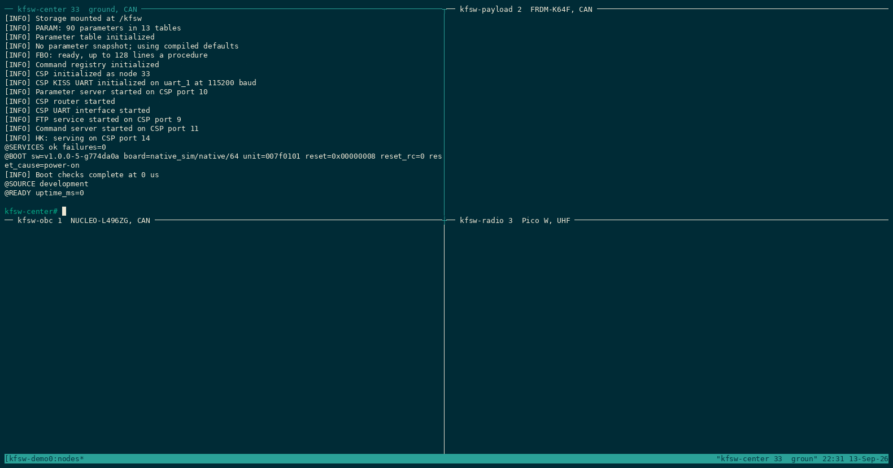

# Boards and targets {#targets}

[TOC]

## Supported targets

A Zephyr board selects the SoC, devices and flash runner. A K-FSW target adds
the application configuration and tool defaults under `config/targets/`; for
example `rpi_pico_w` maps to `rpi_pico/rp2040/w`.

| Target | Zephyr board | Default composition | Tested |
| --- | --- | --- | --- |
| `linux` | `native_sim/native/64` | Shell, storage, parameters, persistence, CSP UART/KISS, remote parameters, FTP | Software tests in CI |
| `nucleo_l496zg` | `nucleo_l496zg` | Same as Linux; shell on ST-LINK, CSP on USART3 | CI build; boot, storage, UART/KISS, CSP, remote parameters and FTP on the bench |
| `frdm_k64f` | `frdm_k64f/mk64f12` | Shell only; full support deferred to tag2.0 | Boot and shell on the board |
| `rpi_pico_w` | `rpi_pico/rp2040/w` | Full service software composition; USB shell, UART0 CSP and persistent LittleFS | Recorded software build success; service HIL NOT RUN |

Only Linux and the NUCLEO are built in CI.

### Required board transports

Every supported hardware board must provide CSP over both CAN and UART/KISS.
Board acceptance must check both links, including normal and Golden application
images where provided. This requirement does not establish automatic route
failover: each composition must define its routes explicitly.

The table above describes current implementations. It does not establish that
every target has completed this transport requirement.

| Board | Current transport status | Remaining work |
| --- | --- | --- |
| NUCLEO-L496ZG | UART/KISS in the board configuration; CAN added by the CAN profile. Prepared update images enable both. | Make dual-link support part of the standard board composition and acceptance matrix. |
| NUCLEO-F746ZG | Prepared A and Golden images (`tools/f746-proof.sh`) use CAN1 PD0/PD1 at 500 kbit/s as the default bus and USART6 UART/KISS for node 1, with route `1 KISS,0/0 CAN`. CAN requires an external transceiver. | Verify both links physically on A and Golden. No observed hardware evidence yet. |
| Pico W | UART/KISS configured; no CAN controller configured. | Select an external CAN controller with a Zephyr driver, define its wiring, check RAM use and test both links. |
| FRDM-K64F | Current application is shell-only despite the board's CAN peripheral. | Include CAN and a dedicated UART/KISS link in the full-service work planned for 2.0. |

The RP2040 has no built-in CAN controller. A CAN transceiver alone is not
sufficient for Pico: the board also needs a CAN controller. Physical wiring and
module selection must be recorded before hardware acceptance.

## Identifying a unit

Every target reports its chip's unique ID: as `unit=` in the boot marker, in
`status` and `version`, and as `hw_id` in the board table. It is 96 bits on the
STM32L496, 128 on the Kinetis K64 and 64 on the RP2040. The CSP model is the
board target, so `csp ident` names the hardware too.



In this recording the FRDM and the Pico run bench configurations with CSP, on
CAN and behind a UHF radio. The `frdm_k64f` and `rpi_pico_w` targets in the
table now have different defaults: FRDM remains shell only, while Pico composes
the services below. The recording does not verify the Pico default image.

## KFSW-Linux

KFSW-Linux is the application built for Zephyr's 64-bit native simulator. It
compiles the same sources as the NUCLEO build, on simulated devices. Use it for
software tests; measure timing, interrupt load and flash behaviour on the MCU.

```bash
./k-fsw/tools/kfsw-linux build
./k-fsw/tools/kfsw-linux run
```

The executable is `build/linux/zephyr/zephyr.exe`, and the runner gives it
`build/linux/kfsw-storage.bin` as flash; tests use their own flash files. The
shell uses stdin/stdout. A line such as

```text
uart_1 connected to pseudotty: /dev/pts/...
```

is the CSP UART, not the console.

CI builds the target and a composition without CSP. Twister runs the unit
tests, the integration and Robot tests start one or two full processes, and
Valgrind checks a normal boot and one with a corrupted snapshot.
`tests/config/linux-node2.conf` configures the second test node.

## NUCLEO-L496ZG

The NUCLEO build enables storage, local and remote parameters, persistence,
CSP, UART/KISS and FTP. Flash is split into a 960 KiB application partition
and a 64 KiB LittleFS partition.

| Connection | Hardware | Use |
| --- | --- | --- |
| Debug console | ST-LINK virtual COM, LPUART1 | Shell, logs and boot markers |
| CSP link | USART3, PD8 TX and PD9 RX | 115200 8N1 KISS |

CSP reception is interrupt driven. The NUCLEO is node 2 and sends traffic for
every other node to the KISS interface.

### Button and LED example

`boton_test` is not in the default image. Build it with:

```bash
KFSW_EXTRA_CONF_FILE="$PWD/k-fsw/config/profiles/nucleo-boton-test.conf" \
KFSW_EXTRA_DTC_OVERLAY_FILE="$PWD/k-fsw/config/profiles/nucleo-boton-test.overlay" \
  ./k-fsw/tools/build.sh nucleo_l496zg
```

The overlay maps the USER button and the green, blue and red LEDs (LD1 to LD3)
to the module's chosen properties, so the pins stay in devicetree. The button
is debounced for 30 ms on the system workqueue, and its values are in table 67.
The manual test is in `tests/hil/boton-test/`.

### Wall clock

`csp clock set <seconds>` sets the wall time. Without an RTC the time is kept
in RAM and lost at reset, and samples collected after the reset have a zero
timestamp.

`config/profiles/nucleo-clock.conf` and `nucleo-clock.overlay` enable the RTC.
It runs from the low-speed oscillator, keeps counting across resets and
low-power states, and survives a power loss when VBAT is connected.

```bash
KFSW_EXTRA_CONF_FILE="$PWD/k-fsw/config/profiles/nucleo-clock.conf" \
KFSW_EXTRA_DTC_OVERLAY_FILE="$PWD/k-fsw/config/profiles/nucleo-clock.overlay" \
  ./k-fsw/tools/build.sh nucleo_l496zg
```

### Last words

The image keeps a short note across a restart and watches the supply voltage, so
a node can report why it went down. `param get last_reason`, `last_detail` and
`last_uptime_ms` read it, and the note is cleared once reported.

### MCUboot

The bootloader is not in the default image. Build it with sysbuild:

```bash
P="$PWD/k-fsw/config/profiles"
KFSW_SYSBUILD=1 \
KFSW_MCUBOOT_KEY="$HOME/.config/kfsw/mcuboot-signing-key.pem" \
KFSW_EXTRA_CONF_FILE="$P/nucleo-mcuboot.conf" \
KFSW_EXTRA_DTC_OVERLAY_FILE="$P/nucleo-mcuboot-flash.overlay;$P/nucleo-mcuboot.overlay" \
KFSW_MCUBOOT_DTC_OVERLAY_FILE="$P/nucleo-mcuboot-flash.overlay" \
  ./k-fsw/tools/build.sh nucleo_l496zg
```

The profiles are in
[config/profiles](https://github.com/dgonzalez97/k-fsw/tree/main/config/profiles):
`nucleo-mcuboot.conf` turns the bootloader on and the two overlays lay out the
flash for it.

| Partition | Address | Size |
| --- | --- | --- |
| `boot_partition` | `0x000000` | 64 KB |
| `slot0_partition` | `0x010000` | 352 KB |
| `slot1_partition` | `0x068000` | 352 KB |
| `kfsw_golden_partition` | `0x0C0000` | 192 KB, recovery image |
| `kfsw_storage_partition` | `0x0F0000` | 64 KB |

The bootloader and the application use the same flash map overlay. The
storage partition stays at `0xF0000`, so an existing filesystem survives the
move to MCUboot; the rollback test checks that a stored value is still there
after every swap. The golden partition holds the recovery image built by
`tools/golden.sh`: the composition in `config/profiles/nucleo-golden.conf`, with
CSP, parameters, the command server and both update routes and nothing else. It
is signed and linked like any other image. The bootloader only boots the slots,
so installing it means copying it into the secondary slot and swapping, which
`golden_install` does on command and the boot service does on its own once an
image has booted unconfirmed more times than `boot_retries` allows.

#### Signing

The signing key is private and kept outside the repository. With
`KFSW_MCUBOOT_KEY` the build puts its public key in the bootloader and signs
the application. Without it MCUboot uses the development key from its own
repository, which anyone can sign with; the rollback test checks for this.

Bootloader settings go in `app/sysbuild.conf` as `SB_CONFIG_*` symbols.
Sysbuild overrides settings placed in a fragment on the bootloader image.

### Watchdog

The hardware watchdog is in the default image, with an 8000 ms timeout, armed at
start. A watchdog that waits for a ground command does not cover a hang before
the first pass, and the STM32 independent watchdog cannot be disarmed once
started. The overlay binds it to `kfsw,watchdog`, because the board's
`watchdog0` alias is the window watchdog, which resets when it is fed too early
and has a much shorter timeout.
The independent watchdog runs from the low-speed oscillator, goes up to about
32 s and keeps running in most low-power states.

The watchdog is armed after all services have started, so a slow boot isn't
reset before the shell is up.

### Build, flash and console

```bash
./k-fsw/tools/build.sh nucleo_l496zg
./k-fsw/tools/flash.sh nucleo_l496zg
./k-fsw/tools/serial.sh nucleo_l496zg 30
```

Use a stable serial path if the default device is wrong:

```bash
KFSW_SERIAL=/dev/serial/by-id/<st-link-device> \
  ./k-fsw/tools/serial.sh nucleo_l496zg 30
```

To debug, start the server in one terminal and the client in another:

```bash
./k-fsw/tools/debugserver.sh nucleo_l496zg
./k-fsw/tools/debug.sh nucleo_l496zg
```

The scripts build first when the ELF is missing.

### Hardware tests

The boot test checks that the ST-LINK is there, builds, flashes, captures the
console and waits for `@BOOT` and `@READY`. The UART/KISS test adds an FTDI
cable and a KFSW-Linux peer, and checks ping, `comms uart test`, storage, a remote
parameter, 4 KiB and 16 KiB transfers and the KISS counters; see
@ref communications. The Holybro profile sets USART3 to 57600 baud for the
radio.

## FRDM-K64F

The `frdm_k64f` target maps to `frdm_k64f/mk64f12` and uses the OpenSDA serial
console and the OpenOCD runner. CSP, parameters, persistence, FTP, storage and
the filesystem are disabled. Full FRDM service support is deferred to tag2.0.

```bash
./k-fsw/tools/build.sh frdm_k64f
KFSW_SERIAL=/dev/serial/by-id/<frdm-console> \
  ./k-fsw/tests/hil/shell-smoke.sh frdm_k64f
```

The test builds, flashes, waits for `kfsw:~$` and runs `status`, `version` and
`help`.

## NUCLEO-F746ZG executable Golden prototype

The default F746 bench profile is unchanged. The opt-in phase 1 composition
uses pinned MCUboot firmware-loader mode, with this erase-aligned map:

| Region | Flash offset range, half open | Budget |
| --- | --- | --- |
| MCUboot | `[0x00000, 0x10000)` | 64 KiB |
| Permanent executable Golden | `[0x10000, 0x40000)` | 192 KiB |
| Running A | `[0x40000, 0x80000)` | 256 KiB |
| Reserved physical file region | `[0x80000, 0x100000)` | 512 KiB |

Flash base is `0x08000000`. Golden links at its own recovery region, including
its MCUboot header; A links at offset `0x40000`, including its header. MCUboot
calls Golden the secondary image internally. This is permanent recovery code;
there is no B update slot or previous-image rollback.

`f746-uart.conf`, `f746-can.conf` and `f746-minimal.conf` compose A with both CSP links,
PARAM and command/status. Golden adds `f746-golden.conf` and keeps CSP and PARAM
status, with commands and shell disabled. Both use node 3, peer 1, route
`1 KISS,0/0 CAN`: CAN is the default bus; UART/KISS uses PG14 TX/PG9 RX
at 115200 8N1. USART3 is not the CSP transport.
These are source compositions, not measured fit or reachability results.

The storage adapter and recovery upload writer are **not delivered in phase 1**.
The physical file region is only reserved; no filesystem, persistence, usable
logical capacity or upload service is claimed. Existing L4 FWU and Golden paths
remain unchanged and are disabled here. Redirecting that FWU implementation to
A would reserve a 256 KiB erase/trailer region and could erase executing code.

Pinned `boot/zephyr/firmware_loader.c` uses `BOOT_VALIDATE_SLOT0` for both
primary and recovery signature validation. `f746-mcuboot.conf` enables that
check on every boot, invalid-A fallback (`BOOT_FIRMWARE_LOADER_NO_APPLICATION`)
and GPIO recovery entrance. `mcuboot-button0` aliases the board user button,
PC13 active high. Pressing the user button at reset requests Golden. If Golden
is invalid on forced entrance, the pinned implementation still tries A; if A
and Golden are invalid it cannot select a valid image. A correctly signed A
that hangs is not detected by this fallback policy.

From this repository root, using an existing signing key:

```bash
# KFSW_MCUBOOT_KEY defaults to ~/.config/kfsw/mcuboot-signing-key.pem.
./tools/f746-proof.sh build "$PWD/build/f746-proof"
./tools/f746-proof.sh check "$PWD/build/f746-proof"
python3 tests/f746-proof-test.py
```

The tool has no flash subcommand. It uses `tools/build.sh` separately for A and
Golden, with sysbuild firmware-updater mode and an MCUboot-only extra config.
The checker reads generated devicetrees, Kconfig, ELF and signed binaries;
checks the common map, entry bounds, complete signed lengths and headers.
Its primary integrity check compares the SHA-256 TLV (type `0x10`) with the hash
of the MCUboot header and payload. It also verifies existing ECDSA signatures
against the generated MCUboot public key. It rejects wrong modes, missing
validation, overlap and oversized artifacts.
Only use trusted locally generated `edt.pickle` files. `check` needs Python's
`cryptography` package and the pinned Zephyr devicetree Python sources.

Real F746 builds, signing and fit reports remain required. A successful offline
proof does not establish boot execution. HIL is **NOT RUN**. Phase 2 still needs
valid-A selection, invalid-A fallback, button entrance, invalid-Golden and
wrong-key refusal evidence, then the platform storage adapter and recovery-only
A writer in their owning repositories. Interrupted upload, bounded erase/write,
filesystem durability and usable capacity need separate tests before physical
power-cut trials. Do not enable the L4 swap path to supply those features.

## Raspberry Pi Pico W

The `rpi_pico_w` target maps to `rpi_pico/rp2040/w`. Its default is a full
service software composition: local and CSP parameters, automatic parameter
persistence, table files, FTP, command service with retry, events and persistent
journal, HK collection, sample files and beacons, retained and remote logs,
last words, allowlisted remexec, FBO and scheduling, limits, resource monitoring,
ground watchdog, hardware watchdog and health supervision. These reuse the
existing owners and application startup sequence. Beacons need a configured
report interval before they transmit.

The USB CDC ACM console and shell remain separate from CSP. The shell waits
for DTR. UART0 uses the board's unchanged `uart0_default` pinctrl at 115200
8N1, without flow control. Pico is CSP v2 node 3, with peer 1 and route
`0/0 KISS`; other nodes on the bench must have distinct addresses and use v2.

| Connection | Pico W header | Peer connection |
| --- | --- | --- |
| CSP UART0 TX | GP0, physical pin 1 | 3.3 V UART RX |
| CSP UART0 RX | GP1, physical pin 2 | 3.3 V UART TX |
| Common ground | GND, physical pin 3 | UART GND |
| Debug shell | USB CDC ACM | Host USB terminal with DTR |

### Flash and RAM contract

The board has 2 MiB of external XIP flash, mapped at `0x10000000`. Partition
offsets below are relative to that address; ranges are half open.

| Region | Offset range | Size |
| --- | --- | --- |
| Zephyr RP2040 boot2 | `[0x000000, 0x000100)` | 256 B |
| Application `code_partition` | `[0x000100, 0x1c0000)` | `0x1bff00` B (1,834,752 B) |
| Persistent LittleFS | `[0x1c0000, 0x200000)` | 256 KiB |

The overlay shrinks the existing board code partition and leaves boot2 intact.
`CONFIG_USE_DT_CODE_PARTITION=y` makes Zephyr generate load offset `0x100` and
load size `0x1bff00`; its linker limits the XIP application to that region.
boot2 stays at `0x10000000`, code starts at `0x10000100`, and storage starts at
`0x101c0000`. The storage partition is aligned to the 4096 B erase sectors.
Zephyr's RP2040 flash driver uses the Pico SDK RAM/ROM flash routines and a
256 B staging buffer while interrupts are locked. No filesystem is placed
over the application or boot2. Flash stalls can delay UART reception and
watchdog feeding; their effects under concurrent transfers and autosave need
physical measurement.

The platform owns the mount at `/kfsw`: erased media is formatted on first
mount, existing media is mounted without formatting, and non-erased corrupt
media is refused. Parameter snapshots, journal, HK files and FTP share this
finite volume. Free-space and full-volume refusals still apply; capacity is
not a promise that every configured ring and upload can coexist.

The existing scratch mount `/kfsw/tmp` uses a separate 32 x 512 B RAM disk,
formatted every boot. Its 16 KiB buffer is allocated by Zephyr in the normal
SRAM region, so the linker counts it against the RP2040's 264 KiB (270,336 B)
SRAM. It leaves at most 248 KiB (253,952 B) for all other static data, stacks,
filesystem caches, driver state and heaps. Main stack is 2048 B, shell stack
3072 B, and remexec adds another 3072 B shell stack plus its default 3072 B
server stack. The libcsp startup heap reservation is 2048 B; CSP buffer,
connection RX queue and QFIFO counts are each 32. Service stack and table
capacities retain their defaults; they have not been reduced to fit.

Build acceptance must inspect `.config`, `zephyr.dts`, `linker.cmd`, the map
and `ram_report` before accepting fit. Resource monitoring is enabled for later
stack measurements. The latest verified prior report records 299,440 B flash
and 263,776 B RAM,
leaving 6,560 B static RAM headroom. This is a tight margin for that recorded
composition, not a new measurement of the current tree. Reproduce the exact
configuration and reports before using those figures for acceptance. Runtime
stack margin and physical behavior remain unverified.

The watchdog starts after service initialization with an 8000 ms timeout,
500 ms health checks and a 4000 ms application deadline. This is below the
RP2040 driver's approximately 8388 ms maximum after erratum RP2040-E1.
The RP2040 RTC is selected for the existing CSP clock adapter; retention
across resets and power loss is not claimed.

### Scope and verification

Full service composition does not mean parity with every optional profile.
MCUboot, FWU, golden recovery and scrub are unsupported by this layout: no
secondary, golden or bootloader partitions are reserved. They need a separate
shared application/bootloader layout contract. The STM32 supply-voltage last
words detector is unavailable on RP2040. CAN, radio crypto, Wi-Fi transport and
example device modules are not composed. Float parameters are disabled as on
the reference boards; the composed tables do not declare them.

The delivered board configuration composes the services listed above. Prior
software builds succeeded; this documentation update runs no new build.
Earlier physical evidence covers USB shell bring-up only. Pico service HIL is
**NOT RUN**. Before physical acceptance,
verify USB shell and boot markers, storage write/reset/read, parameter
save/reset/restore, bidirectional CSP ping and effective routes, remote PARAM,
FTP integrity and full-volume refusal, HK/log reads, remexec allowlist refusal,
FBO/limits actions and watchdog recovery. Record UART error/drop counters while
flash is being written. A corrupt non-erased filesystem must remain unformatted.

From the isolated repository root, build and inspect the generated reports:

```bash
repo="$PWD"
export KFSW_OUTPUT_ROOT="$repo/build/pico-services"
KFSW_PRISTINE=always "$repo/tools/build.sh" linux
KFSW_PRISTINE=always "$repo/tools/build.sh" rpi_pico_w
west build -d "$KFSW_OUTPUT_ROOT/rpi_pico_w" -t ram_report
west build -d "$KFSW_OUTPUT_ROOT/rpi_pico_w" -t rom_report
```

Hosted storage, persistence, CSP, FTP, HK, remexec, FBO and limits regressions
must use the Linux executable from that output root. Builds and hosted tests
are not rerun by this documentation update; recorded Pico build success does
not establish hosted regression or physical acceptance. Existing NUCLEO-only
physical scripts retain
their restrictions: Pico flash and USB console contracts have not been added
to those service tests. `tests/hil/shell-smoke.sh rpi_pico_w` remains only a
shell bring-up check, using the UF2 runner and a stable USB serial identity;
manual UF2 installation can use its existing `KFSW_FLASH=0` path.

## Shell test and target files

`tests/hil/shell-smoke.sh` has the test steps, and each target's `.env` file
has the board details:

```text
test step                     target file
build                         Zephyr board
flash (optional)        <--   flash USB ID and runner
open the console        <--   USB ID, serial path and baud
wait for the prompt     <--   expected prompt
status, version, help
```

A new shell target only needs its own `.env` file, unless its hardware behaves
differently.

## Adding a target

A new target needs:

1. a Zephyr board, upstream or in the project;
2. `config/targets/<name>.env` with the board and tool settings;
3. `app/boards/<board>.conf` with the default composition;
4. an overlay if K-FSW has to choose a UART, storage partition or console;
5. a clean build;
6. software tests for any new shared code; and
7. a hardware test for the services it enables.

Moving the NUCLEO configuration to another board also means checking the
storage layout, UART wiring, flash runner, console and memory sizes.
